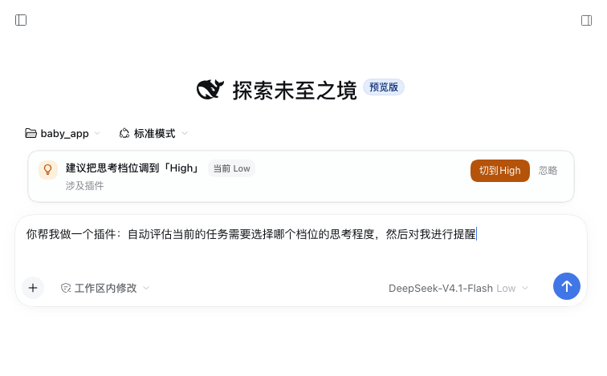

# dsh-plugin-thinking-level

把思考强度花在刀刃上：根据当前任务和最近几轮对话在本地判断合适的推理等级，一键切换；会话过长时提醒并可直接新建会话。简单任务不过度思考、节省 token，复杂任务给足推理、不因思考不足返工。



> 只提醒，不自动切。判定在本地完成，不联网、不上传草稿。

## 为什么能省 token

- **简单任务用低档**：改文案、翻译、列清单这类直接任务，不需要长链条推理，低档可以减少无效的 reasoning token。
- **复杂任务用高档**：排查、重构、跨端、并发这类任务，思考不足往往导致多轮返工，返工比多思考更贵。
- **只在档位不匹配时提醒**：当前档位已经合适就不打扰，避免提醒本身变成噪声。
- **升档更保守**：分数要到 7 才建议高档，减少“为了保险先拉满”造成的 reasoning token 浪费。
- **一键切换**：走 DSH 模型菜单同一个 `selectModel` 接口，不用再打开模型菜单逐项点。

## 行为

只在「这句话要我干活、而且当前档位不合适」时才提醒，三道闸门：

1. **意图闸门**：先判断这句是请求还是陈述。纯描述（“今天宝宝体检完了”“刚才构建失败了”“我觉得这个颜色有点深”）一律沉默；出现「帮我 / 请 / 能不能 / 改成 / 排查 / 为什么 / ？」这类请求信号才会评估。
2. **历史闸门**：读取最近 6 轮的 prompt / response 预览（`turnOutline`），判断是不是同一个任务：
   - 同一任务继续、又没有新的复杂度信号：只有分数 ≥ 8 的明显升档才提醒；
   - 非新任务的追问：不提示降档，避免一句话把长任务误判成简单任务；
   - 明确换任务（“另外 / 换个 / 新任务 / 重新开始”）：按新任务正常评估。
3. **上下文闸门**：子代理会话完全不提醒；模型没有可切换的推理等级时也不提醒。

另外：

- **只对提供推理等级的模型提醒**。没有推理等级、或只有一个固定等级的模型，完全不显示卡片；绝不用一套假想的「低/中/高」去套别的模型。
- **档位名用模型自己的写法**：`Low / High / Max`、`Minimal / Low / Medium / Xhigh / Max` 之类都按 catalog 原样显示；模型没有 `high` 时落到最接近的真实档位（例如三档模型的 `Xhigh`），不凭空造档。
- 输入框为空、以 `/` 开头的命令、或少于 6 个字符时不提醒。
- 当前档位已经合适时不打扰。
- **项目上下文**：工作区路径包含 `baby_app`，且草稿或最近几轮提到安卓 / 鸿蒙 / iOS / Flutter / ArkTS / SwiftUI 并要改动时，会按三端口径同步规则升一档，理由显示“当前项目三端同仓”或“涉及三端口径同步”。
- **补漏信号**：线上 / 偶尔 / 复现 / 超时 / 卡死 / 数据不一致 / 4xx–5xx 接口等，会额外加分，减少复杂排查漏报。
- 提醒卡会说明理由，例如“涉及重构、排查、根因 · 涉及三端口径同步”。
- 点 **切到 High / 降到 Low**（按模型实际档位名显示）会切换当前会话的推理等级；点 **忽略** 后同一段草稿（小改动不超过 30 字）不再出现。
- 同一档位被忽略后，本会话内更苛刻才再提醒：升到高需要分数 ≥ 8、中需要 ≥ 5，降档只提醒一次。

## 判定规则

本地启发式，不调用模型，零网络：

- **意图信号**（先决条件）：帮我、请、麻烦、能不能、看下、改成、修一下、实现、生成、发布、排查、为什么、如何、是不是，或以问号结尾。
- **强信号**：架构、重构、排查、调试、根因、并发、性能、安全、迁移、跨端、协议、算法、实现、开发、插件、集成、兼容、崩溃、报错、异常、数据丢失等。
- **中信号**：修改、新增、修复、检查、测试、接口、字段、配置、评估、验证等。
- **弱信号**：翻译、格式化、改名、文案、列出、颜色、字体、简单、只需要等。
- **结构信号**：文本长度、代码块、堆栈/报错、多个文件路径、多步连接词、多个问号、约束数量。

分数 `>= 7` → 高，`3–6` → 中，`<= 2` → 低；追问时只放行 `>= 7`（同一任务继续要 `>= 8`），不再提示降档。省 token 优先，所以升档比旧版更保守。关键词和阈值都在 [`lib/client.js`](lib/client.js) 顶部的常量里，按自己的习惯改即可。

## 会话过长提醒

同一个会话继续太久，历史上下文会越来越长，每轮更慢、更贵。达到任一阈值时，输入框为空会显示一张“建议新开会话”卡片：

- 已结束轮次 ≥ 15；或
- 缓存感知的有效 token ≥ 100k。

有效 token 不是简单累加，而是考虑缓存命中：

```text
effective = uncachedInputTokens + cacheWriteTokens + outputTokens + cacheReadTokens × 0.1
cacheHit   = cacheReadTokens / (uncachedInputTokens + cacheReadTokens + cacheWriteTokens)
```

缓存命中率高时，大量 token 是约 1/10 单价的缓存读取，不会因为总量虚高就误报。卡片会显示轮次、累计 token、缓存命中率和估算计费。

- **新建会话**：在当前工作区直接开一个新会话（`ctx.sessions.create` + `open`），按钮有加载态，失败会显示原因。
- **本会话不再提醒**：忽略后，再增加 15 轮才会重新提示。
- 有草稿时优先显示档位提醒，不抢位置。

## 安装

```sh
dsh plugin --profile desktop add github:zmd12345/dsh-plugin-thinking-level
```

本地开发安装：

```sh
dsh plugin --profile desktop add /path/to/dsh-plugin-thinking-level
```

安装后刷新页面；如果 host 没有热加载到新的 bundle，重启一次 DSH Desktop。

## 隐私与副作用

- 只读取当前输入框草稿和最近 6 轮对话预览，用于本地判断是否同一任务。
- 不发送草稿到任何服务器，不写入文件。
- 只有你点“切换”时，才会调用 DSH 的 `selectModel` 修改当前会话的推理等级。
- 点“忽略”不会修改任何设置。

## 开发与测试

```sh
node test/client.test.mjs
```

测试直接加载 `lib/client.js`，校验 `__ModuleLoader__` 协议、导出、17 条草稿判定、5 条追问判定、4 条历史上下文判定，以及会话指标；组件用例覆盖档位卡、会话卡、加载态和忽略。

## English

Suggests the right thinking level for the current draft and can switch it in one click: simple tasks do not burn tokens on overthinking, hard tasks get enough reasoning to avoid rework. The check is a local heuristic; the draft never leaves your machine. Nothing changes until you click the switch button.

## License

MIT
